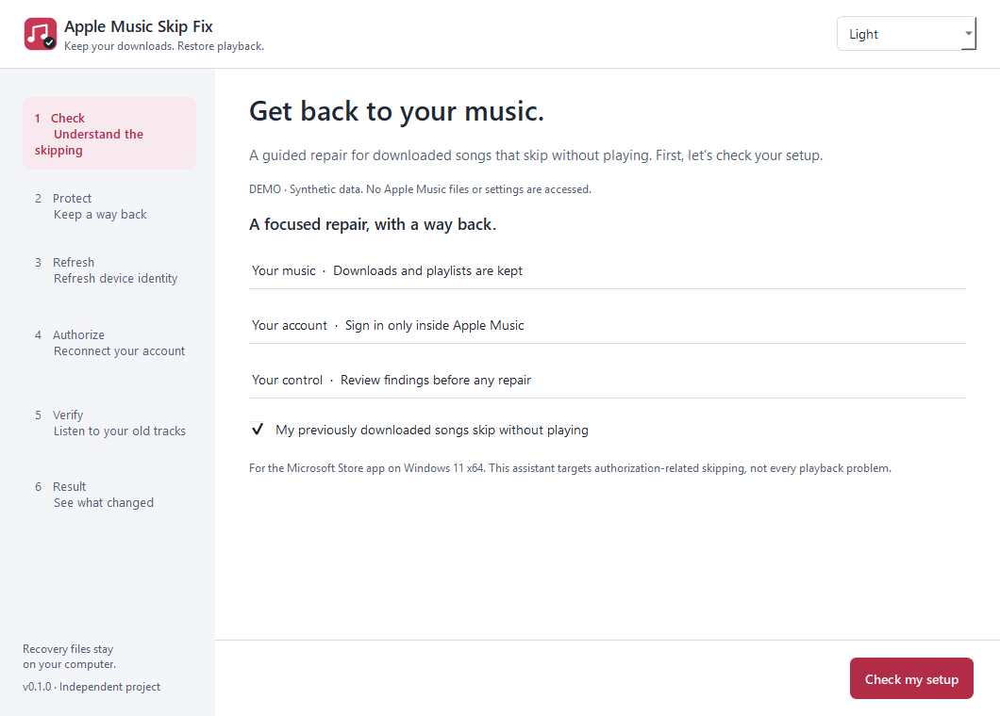
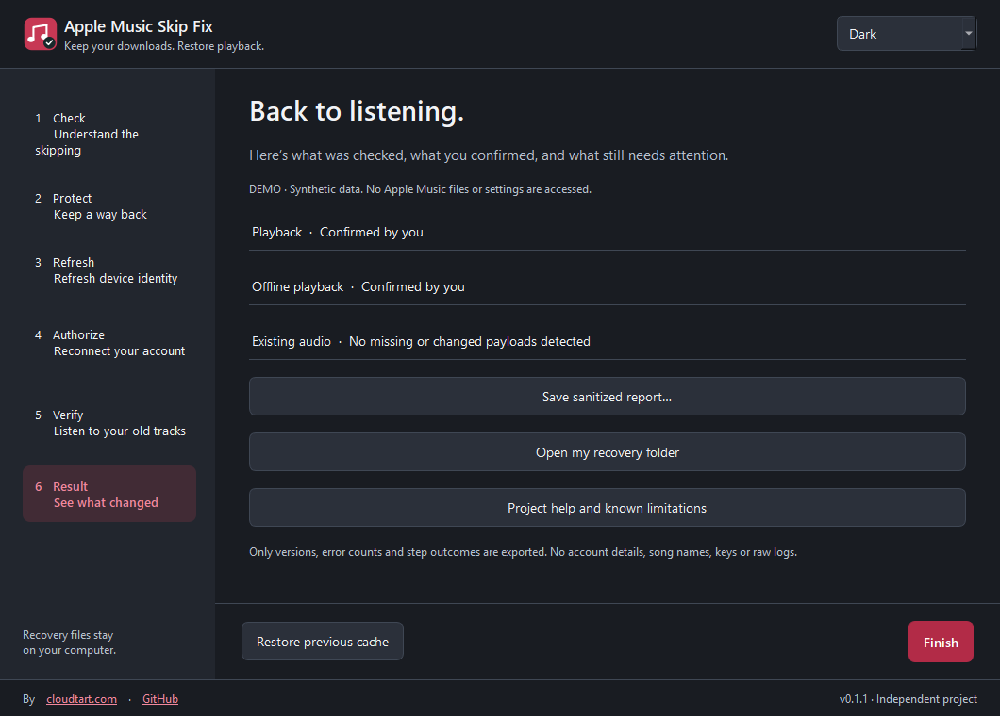

# Apple Music Skip Fix

A free Windows assistant for **Apple Music songs that skip without playing**, including previously downloaded tracks.

Keep your downloads. Protect your library. Refresh device authorization with a guided, reversible workflow.

Independent open-source software. Not made by, affiliated with, or endorsed by Apple.

## Download

**[Download the Windows installer](https://github.com/farshad-zamani/apple-music-skip-fix/releases/download/v0.1.0/AppleMusicSkipFix-0.1.0-Setup.exe)** · [Portable ZIP](https://github.com/farshad-zamani/apple-music-skip-fix/releases/download/v0.1.0/AppleMusicSkipFix-0.1.0-Portable.zip) · [All releases](https://github.com/farshad-zamani/apple-music-skip-fix/releases)

- **Setup.exe:** recommended; installs for your Windows user.
- **Portable.zip:** extract the entire folder, then open `AppleMusicSkipFix.exe`.
- No Python installation, payment, account, telemetry, or background service.
- Version 0.1 targets **Windows 11 x64** and the **Microsoft Store Apple Music app**. Windows 10, ARM64, iTunes, macOS and third-party players are outside this release's support scope.

The first release is unsigned. Windows may show an unrecognized-publisher notice. Verify the source and SHA-256 checksums; do not disable antivirus to use this tool.

Compare this command's result with the matching filename in [SHA256SUMS.txt](https://github.com/farshad-zamani/apple-music-skip-fix/releases/download/v0.1.0/SHA256SUMS.txt):

```powershell
Get-FileHash .\AppleMusicSkipFix-0.1.0-Setup.exe -Algorithm SHA256
```





## What it does

1. **Check:** detects your installation and reads recent diagnostics. It does not assume that every skipping problem is a DRM problem.
2. **Protect:** closes Apple Music gracefully, backs up essential library metadata, preferences and ADI data, verifies recovery copies with SHA-256, and inventories existing audio.
3. **Refresh:** renames the existing ADI authorization-cache directory in place. It preserves the original cache, including its permissions. A narrowly scoped helper requests Windows permission only if needed.
4. **Authorize:** opens Apple Music and, when its UI is recognized, opens **Authorize Machine**. Otherwise it shows the exact manual steps.
5. **Verify:** observes 30 seconds of real progress on two different old downloads and a playback test after reopening. You confirm that the audio is continuous. Offline testing is optional and separately recorded.
6. **Result:** shows what was actually verified and lets you save an allowlisted report or restore the previous authorization cache.

**Your password and verification code belong only in Apple's window.** This app never reads or fills those fields.

## Before you start

Use this only if songs downloaded **before the problem began** skip without playing. Check that your Apple Music subscription is active and your music drive is connected. Newly downloaded or streamed tracks playing correctly does not prove your old downloads are fixed.

The shared Apple device-authorization cache may also be used by other Apple apps. They may ask you to authorize again. Close their windows if the cache is busy. The tool does not stop Apple services or force-kill apps.

If your Media location is custom, choose the folder shown in **Apple Music → Settings → Files → Media folder location**. The library folder normally ends in `.musiclibrary` and contains `Library.musicdb`.

## What stays unchanged

The repair engine does not write music payloads, change playlists or library databases, remove downloads, sign you out, alter quality or sound settings, edit the registry, change the network, install drivers, or bypass DRM. It is not a music converter or downloader.

Audio preservation is checked by inventory (size and modification time); the tool does **not** claim to hash every byte of a large music library. Recovery metadata copies are SHA-256 verified.

## Recovery

Private recovery files are stored under `%LOCALAPPDATA%\AppleMusicSkipFix\Sessions\<session-id>`. The original ADI directory stays beside its original location under the OS-resolved ProgramData folder, with a unique `adi.apple-music-skip-fix.<session-id>.backup` name.

**Restore previous cache** closes Apple Music, keeps the fresh cache as `.after`, and renames the original cache back. It never restores or overwrites a library database. If the app closes unexpectedly, reopen it to resume the saved session. Keep recovery files until you are satisfied with the result. Uninstalling the assistant does not delete them.

These private backups can contain account-related authorization data. Do not attach them to an issue or public repository. Use **Save sanitized report** instead.

## Troubleshooting

| Situation | What to do |
| --- | --- |
| No matching errors in the logs | Missing logs are not proof of a faulty cache. Confirm the exact symptom; other playback issues need Apple's general help. |
| Music folder unavailable | Reconnect its drive and select the actual Media folder. |
| Apple Music still running | Close open dialogs and its window, wait for the library agent to exit, then retry. |
| Windows permission declined | The verified backup remains available. Retry Refresh when permission is available. |
| Authorize screen not opened automatically | Click your account name in Apple Music's sidebar → Authorize Machine. |
| Authorization limit reached | Follow Apple's account-management guidance. This tool never deauthorizes all your devices. |
| Media-session observation unavailable | Use the explicitly labeled manual 30-second playback confirmation. |
| Playback still fails | Keep your backups, save the sanitized report, consider restoring the previous cache, and open a GitHub issue. Repeated resets are not a general solution. |
| Offline not tested | Results keep that state. The assistant never disconnects your computer or labels an unperformed test successful. |

## Evidence and limits

The workflow grew out of a real Windows 11 repair: previously downloaded tracks failed with content-key errors (`-11800/-42812`) and an ADI-related error (`-45061`). Rebuilding the cache followed by official reauthorization restored playback while preserving approximately 45 GB of existing media. The user later confirmed offline playback. This is **one machine's experience**, not a success-rate claim or an Apple-defined explanation of every error code. We did not isolate the causal effect of reauthorization from the preceding cache refresh.

An error such as `-42812` is a diagnostic clue, not a universal diagnosis. Account, catalog, network, audio-device and other problems may require different fixes.

## Privacy

No analytics, telemetry, server, advertising, or automatic update checks. Windows adapters run locally. Online sign-in occurs inside Apple Music; help links open only when clicked.

Shareable JSON contains app/OS versions, recognized error-code counts, repair status and verification booleans. It excludes raw logs, keys, library databases, paths, usernames, email addresses and song names. Demo screenshots contain only synthetic data.

## Development

```powershell
python -m venv .venv
.\.venv\Scripts\python -m pip install -e ".[dev]"
.\.venv\Scripts\python -m amsf --demo
.\.venv\Scripts\python -m pytest
```

Run the actual assistant without `--demo` only when you intend to diagnose an installation. `--self-check` performs a read-only Windows adapter check. `--demo --page result --theme dark` previews a complete synthetic workflow. Never use real account data as a test fixture.

See [architecture and safety boundaries](docs/ARCHITECTURE.md), [building a release](docs/BUILDING.md), and [test coverage](docs/TESTING.md).

## References

- [Apple: authorize or deauthorize a Windows PC](https://support.apple.com/en-us/118292)
- [Apple: problems playing music on Windows](https://support.apple.com/guide/music-windows/if-you-have-problems-playing-music-mus6eab7529d/windows)
- [Community report: downloaded songs skipping](https://www.reddit.com/r/AppleMusic/comments/16fzi57/)
- [Independent ADI troubleshooting observations](https://github.com/N20xDuli/apple-music-windows-drm-fix) — separate machine and circumstances; not a universal fix.

## License

Application source: [MIT](LICENSE). Python, Qt/PySide6 and other bundled components retain their own licenses; see [third-party notices](THIRD_PARTY_NOTICES.md) and the license files in the distribution. Qt libraries are bundled dynamically in the portable directory.

Created by [farshad-zamani](https://github.com/farshad-zamani). Apple and Apple Music are trademarks of their respective owner.
